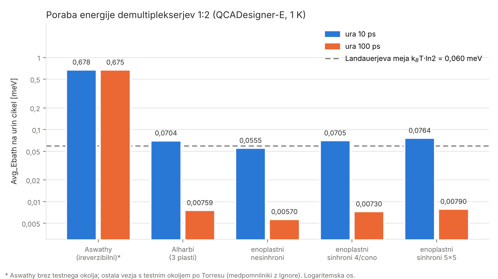
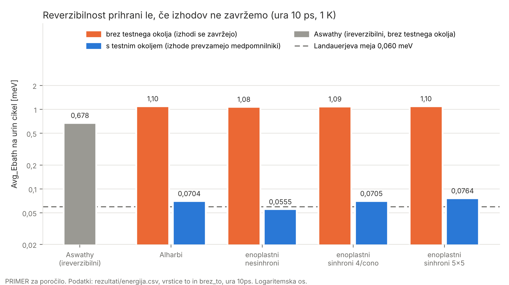
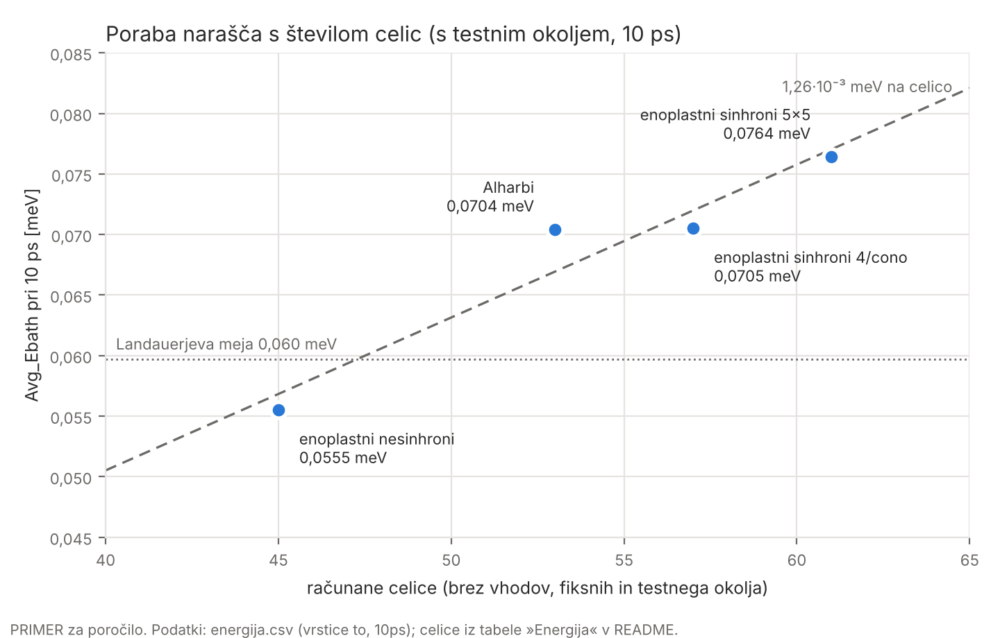
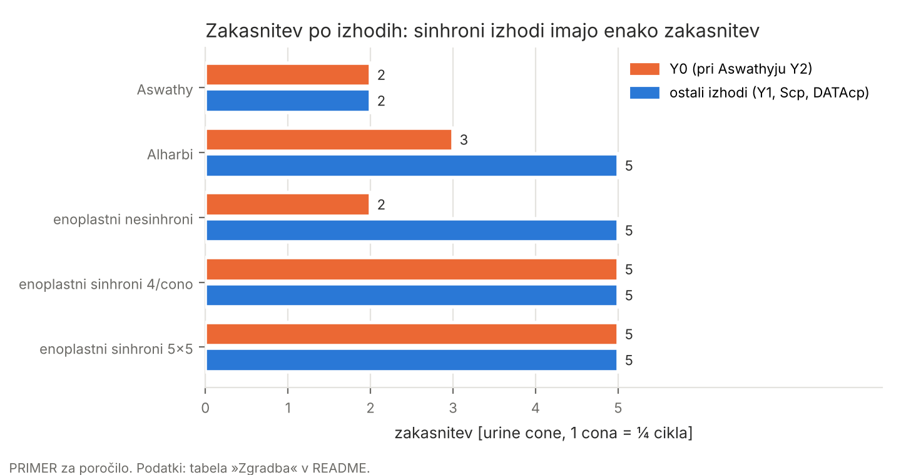

# Enoplastni fizično reverzibilni demultiplekser s sinhronimi izhodi v QCA

Skupina 21 (Tara Majkič, Miha Vintar, Jaka Pelko), NPMP 2026/27

## Vsebina repozitorija

```
docs/                          prijava teme
gradniki/                      osnovni gradniki: vodilo, negator, majoritetna vrata, AND, OR
patches/                       naši popravki QCADesigner-E (popravki sesutij, Reset Polarization)
rezultati/                     energija.csv (vse meritve) in primeri diagramov
vezja/
  1_aswathy/                   ireverzibilni DEMUX (referenca)
  2_alharbi/                   reverzibilni DEMUX s križanjem (izhodišče)
  3_enoplastni/                naš: ena plast, izhodi nesinhroni
  4_enoplastni_sinhroni/       naš: ena plast, sinhroni izhodi (vmesna različica)
  5_enoplastni_sinhroni_5x5/   naš: ena plast, sinhroni izhodi, ploščice 5×5 (končna)
.dockerignore                  datoteke, ki jih Docker ne kopira v sliko
docker-compose.yml             zagon QCADesigner-E v Dockerju
Dockerfile                     prevajanje QCADesigner-E s popravki
Makefile                       make run (zagon), make pdf PS=… (pretvorba .ps v PDF)
README.md                      ta opis
```

Mape vezij od 2 do 5 imajo enako zgradbo:

| podmapa | vsebina |
|---|---|
| `vezje/` | vezje, kot gre v poročilo: `<ime>.qca`, slika `<ime>.pdf`, grafa `<ime>_10ps.pdf` in `<ime>_100ps.pdf` |
| `testno_okolje/` | vezje s testnim okoljem za meritve energije: `<ime>_to.qca`, slika in grafa s pripono `_to` |

Ob vsakem PDF je izvorna `.ps` (File → Print → File v QCADesigner-E). `_10ps` in `_100ps` označujeta hitrost ure pri simulaciji (Clock Slope 1e-11 s oz. 1e-10 s).

## Vezja

| mapa | opis | vir | celice | plasti | izhodi |
|---|---|---|---|---|---|
| `1_aswathy/` | ireverzibilni DEMUX 1:2 | Aswathy in sod. 2024, slika 6b | 15 | 1 | Y1, Y2 |
| `2_alharbi/` | fizično reverzibilni DEMUX 1:2 s trislojnim križanjem | Alharbi in sod. 2022, slika 12 | 55 | 3 | Y0, Y1, Scp, DATAcp |
| `3_enoplastni/` | brez križanja, izhodi nesinhroni | naša implementacija (izboljšava Alharbija) | 47 | 1 | Y0, Y1, Scp, DATAcp |
| `4_enoplastni_sinhroni/` | brez križanja, vsi izhodi hkrati, ni po ploščicah 5×5 | naša implementacija (izboljšava Alharbija) | 59 | 1 | Y0, Y1, Scp, DATAcp |
| `5_enoplastni_sinhroni_5x5/` | brez križanja, vsi izhodi hkrati, po ploščicah 5×5 | naša implementacija (izboljšava Alharbija) | 63 | 1 | Y0, Y1, Scp, DATAcp |

- **Celice** so štete brez testnega okolja, z vhodi in fiksnimi celicami. Pri Alharbiju je 55 = 48 celic v glavni plasti + 7 celic križanja (2 navpični + 5 v drugi plasti). Na sliki jih je vidnih manj, ker se celice različnih plasti na istem mestu prekrivajo.
- **Funkcije izhodov:** Y0 = S·DATA, Y1 = S̄·DATA, Scp = S̄ (kopija S), DATAcp = DATA (kopija DATA).
- **Oznake pri Aswathyju** so ohranjene kot v članku: D = DATA, Y1 = S̄·DATA (kot pri nas), Y2 = S·DATA (pri nas Y0).

**Testno okolje** (Alharbi in sod. 2022, razdelek 2 in slika 6, po Torres in sod. 2018): pred vsak vhod in za vsak izhod vezja dodamo nekaj medpomnilniških celic, ki se ne štejejo v energijo (v QCADesigner-E vklopljen *Ignore Energy Dissipation*). Pri nas so to 4 medpomnilniki na vsakem vhodu in izhodu. Testno okolje doda vezju 30 celic: 2 novi vhodni celici in 28 celic z Ignore (8 medpomnilnikov na vhodih, 16 na izhodih in 4 izhodne celice). Aswathy testnega okolja nima, ker vhod S obdaja logika in medpomnilnikov ni mogoče dodati.

## Nastavitve simulacije
 
QCADesigner-E, *Coherence Vector (w/ Energy)*, *Exhaustive Verification*. Fizikalne nastavitve so pri vseh simulacijah enake in enake kot pri Alharbiju in sod. 2022 (tabeli 1 in 2):
 
| parameter | vrednost |
|---|---|
| Temperature | 1 K |
| Relaxation Time | 1e-15 s |
| Time Step | 1e-16 s |
| Clock High / Clock Low | 9,8e-22 J / 3,8e-23 J |
| Clock Shift | 0 |
| Radius of Effect | 80 nm |
| Relative Permittivity | 12,9 |
| Layer Separation | 11,5 nm |
| oblika ure | GAUSS |
| metoda | Euler |
| Randomize Simulation Order | vklopljeno |
| Zeroing of Inputs | vklopljeno |
 
**Zeroing of Inputs** (privzeto vklopljeno) vhodno celico pred vsako novo vrednostjo za pol cikla postavi na 0, tako kot bi se obnašala zadnja celica prejšnjega vezja z uro. Alharbi jo je imel izklopljeno; preverili smo, da to porabo spremeni za manj kot 1 % (0,0704 proti 0,0710 meV pri 10 ps).


### Hitrost ure
 
Vsako vezje simuliramo pri dveh hitrostih ure. Hitrost določajo štiri nastavitve:
 
| hitrost | Clock Slope | Clock Period = Input Period | Total Simulation Time | ciklov |
|---|---|---|---|---|
| **100 ps** – nastavitve iz Alharbijevega članka | 1e-10 s | 1e-9 s | 8e-9 s | 8 |
| **10 ps** – enako, a 10-krat hitrejša ura | 1e-11 s | 1e-10 s | 8e-10 s | 8 |
| privzete nastavitve QCADesigner-E (le za preverbo Aswathyja) | 1e-12 s | 4e-12 s | 5e-11 s | 12,5 |
 
- **Clock Slope** je čas prehoda ure med nizko in visoko vrednostjo; po njem hitrost poimenujemo. Počasnejši prehod pomeni manj oddane toplote. Pri fizično reverzibilnih vezjih poraba s počasnejšo uro močno pade, pri ireverzibilnih ne, zato simuliramo pri dveh hitrostih.
- **Clock Period** je 10 × Clock Slope (kot pri Alharbiju), da ura v vsakem ciklu doseže polno vrednost.
- **Input Period** je enak periodi ure: kombinacija vhodov se zamenja enkrat na cikel.
- Izpis energije ima pri 8 ciklih 7 vrednosti E_bath_total. Po tem preverimo, da je simulacija tekla s pravimi nastavitvami.

## Rezultati

Avg_Ebath je povprečna disipacija na urin cikel brez celic z Ignore. Landauerjeva meja pri 1 K: kBT·ln2 = 0,060 meV. Simulacija se konča sredi zadnjega cikla, ki ga simulator vseeno šteje v povprečje; to Avg_Ebath pri vseh vezjih enako zniža (~10 %), zato so vezja med seboj primerljiva. Vse meritve so tudi v `rezultati/energija.csv`.

**S testnim okoljem** (glavne meritve, 28 celic z Ignore):
 
| vezje | ura | Sum_Ebath [meV] | Avg_Ebath [meV] | napaka Avg [meV] |
|---|---|---|---|---|
| Alharbi | 10 ps | 0,493 | 0,0704 | −0,0036 |
| Alharbi | 100 ps | 0,0531 | 0,00759 | −0,00023 |
| enoplastni | 10 ps | 0,388 | 0,0555 | −0,0027 |
| enoplastni | 100 ps | 0,0399 | 0,00570 | −0,00006 |
| enoplastni sinhroni | 10 ps | 0,493 | 0,0705 | −0,0034 |
| enoplastni sinhroni | 100 ps | 0,0511 | 0,00730 | −0,00018 |
| enoplastni sinhroni 5×5 | 10 ps | 0,535 | 0,0764 | −0,0038 |
| enoplastni sinhroni 5×5 | 100 ps | 0,0553 | 0,00790 | −0,00017 |

**Brez testnega okolja** (vezja, kot so v mapah `vezje/`: vhodni celici S in DATA sta neposredno na vratih, izhodi so zadnje celice vezja):
 
| vezje | ura | Sum_Ebath [meV] | Avg_Ebath [meV] | napaka Avg [meV] |
|---|---|---|---|---|
| Aswathy | 10 ps | 4,75 | 0,678 | −0,076 |
| Aswathy | 100 ps | 4,72 | 0,675 | −0,076 |
| Alharbi | 10 ps | 7,71 | 1,10 | −0,119 |
| Alharbi | 100 ps | 7,43 | 1,06 | −0,118 |
| enoplastni | 10 ps | 7,56 | 1,08 | −0,118 |
| enoplastni | 100 ps | 7,38 | 1,05 | −0,117 |
| enoplastni sinhroni | 10 ps | 7,66 | 1,09 | −0,118 |
| enoplastni sinhroni | 100 ps | 7,39 | 1,06 | −0,117 |
| enoplastni sinhroni 5×5 | 10 ps | 7,71 | 1,10 | −0,119 |
| enoplastni sinhroni 5×5 | 100 ps | 7,39 | 1,06 | −0,117 |


`alharbi.qca` (v `2_alharbi/vezje/`) je Alharbijev DEMUX točno tako, kot je na sliki 12 v članku: vhoda S in DATA sta na krakih levih vrat, izhodi so zadnje celice vezja, brez medpomnilnikov in brez Ignore. Namen: primerjava z Aswathyjem pod enakimi pogoji (oba brez testnega okolja).



 
*Povprečna poraba na urin cikel pri 10 ps in 100 ps (logaritemska os). Reverzibilna vezja pri 10-krat počasnejši uri porabijo približno 10-krat manj in so pri 100 ps vsa pod Landauerjevo mejo; ireverzibilni Aswathy porabi pri obeh hitrostih enako. Aswathy brez testnega okolja, ostala vezja s testnim okoljem.*


## Primerjalna tabela vezij

Vse vrednosti so izračunane iz končnih datotek `.qca` (zakasnitve, površine in ploščice so bile izračunane s skripto med pripravo) in iz meritev v tabeli zgoraj. Aswathy je izjema: celice, površina in zakasnitev so iz članka (tabela 4), energija pa iz naše meritve brez testnega okolja, ker vhodnih medpomnilnikov pri tem vezju ni mogoče dodati.

### Zgradba

| vezje | celice | plasti | križanje | ploščice 5×5 | površina [µm²] | zakasnitev Y0 | kritična zakasnitev | sinhroni izhodi |
|---|---|---|---|---|---|---|---|---|
| Aswathy 2024 (ireverzibilni) | 15 | 1 | ne | – | 0,02 | 2 con (0,50 cikla) | 2 con (0,50 cikla) | da |
| Alharbi 2022 (rekonstrukcija) | 55 | 3 | da (večplastno) | 7 | 0,0650 | 3 con (0,75 cikla) | 5 con (1,25 cikla) | ne |
| enoplastni nesinhroni | 47 | 1 | ne | 8 | 0,0522 | 2 con (0,50 cikla) | 5 con (1,25 cikla) | ne |
| enoplastni sinhroni, 4 celice/cono | 59 | 1 | ne | – (5 neujemanj) | 0,0853 | 5 con (1,25 cikla) | 5 con (1,25 cikla) | da |
| enoplastni sinhroni 5×5 | 63 | 1 | ne | 11 | 0,0886 | 5 con (1,25 cikla) | 5 con (1,25 cikla) | da |

- **Celice** vključujejo vhodni celici S in DATA ter obe fiksni celici (enako šteje Aswathy). Pri Alharbiju so vštete tudi celice križanja v drugih plasteh.
- **Površina** je pravokotnik okoli vseh celic vezja (brez testnega okolja), kot jo izpiše QCADesigner. Pri postavitvi po ploščicah je dejanska površina število ploščic × 0,01 µm² (Alharbi 0,07, nesinhroni 0,08, 5×5 0,11 µm²).
- **Zakasnitev** je število urinih con na najdaljši poti od vhoda do izhoda, vključno s cono vhoda; ena cona je ¼ cikla. Pri Alharbiju se izračun ujema s člankom (Y0 3 cone, Y1 5 con), kar potrjuje metodo. Pri Aswathyju je 0,5 cikla iz članka.
- **Sinhroni izhodi**: vsi izhodi imajo enako zakasnitev. Pri Alharbiju in nesinhroni različici pride Y0 prej (3 oz. 2 coni) kot ostali izhodi (5 con).

### Energija (1 K, testno okolje po Torresu, razen Aswathy)

Landauerjeva meja kBT·ln2 pri 1 K = 0,0597 meV. »Računane celice« so vse celice, ki jih simulator šteje v energijo (brez vhodnih, fiksnih in tistih z Ignore).

| vezje | računane celice | Avg_Ebath 10 ps [meV] | Avg_Ebath 100 ps [meV] | razmerje 10/100 | 10 ps / kBT·ln2 | 100 ps / kBT·ln2 | na celico 10 ps [meV] | na celico 100 ps [meV] |
|---|---|---|---|---|---|---|---|---|
| Aswathy 2024 (ireverzibilni) | 11 | 0,678 | 0,675 | 1,00 | 11,35 | 11,301 | 0,0616 | 0,0614 |
| Alharbi 2022 (rekonstrukcija) | 53 | 0,0704 | 0,00759 | 9,3 | 1,18 | 0,127 | 0,00133 | 0,000143 |
| enoplastni nesinhroni | 45 | 0,0555 | 0,0057 | 9,7 | 0,93 | 0,095 | 0,00123 | 0,000127 |
| enoplastni sinhroni, 4 celice/cono | 57 | 0,0705 | 0,0073 | 9,7 | 1,18 | 0,122 | 0,00124 | 0,000128 |
| enoplastni sinhroni 5×5 | 61 | 0,0764 | 0,0079 | 9,7 | 1,28 | 0,132 | 0,00125 | 0,00013 |

- Pri Aswathyju je energija merjena brez testnega okolja. Za primerjavo pod enakimi pogoji: Alharbi brez testnega okolja porabi 1,10 meV (10 ps) in 1,06 meV (100 ps), razmerje 1,04 (glej »Alharbi brez testnega okolja …«).
- **Fizična reverzibilnost** se kaže v razmerju 10/100: pri ireverzibilnem vezju ~1, pri reverzibilnih ~10 (poraba pada linearno s hitrostjo ure).
- **Pod Landauerjevo mejo** (razmerje < 1): pri 100 ps vsa reverzibilna vezja, pri 10 ps le enoplastna nesinhrona različica.
- Energija na celico je pri vseh reverzibilnih vezjih skoraj enaka (0,0012–0,0013 meV pri 10 ps), zato razlike v skupni porabi izhajajo predvsem iz števila celic. Za primerjavo različic je merilo skupna poraba (glej »Ploščice 5×5 … in dolžina con«).

### Cena

| vezje | cena po Aswathyju (celice × površina × zakasnitev) | površina × zakasnitev² [µm²·cikel²] |
|---|---|---|
| Aswathy 2024 (ireverzibilni) | 0,15 | 0,0050 |
| Alharbi 2022 (rekonstrukcija) | 4,47 | 0,1016 |
| enoplastni nesinhroni | 3,07 | 0,0816 |
| enoplastni sinhroni, 4 celice/cono | 6,29 | 0,1333 |
| enoplastni sinhroni 5×5 | 6,98 | 0,1384 |

- **Formula po Aswathyju** je preverjena na tabeli 4 v članku: celice × površina [µm²] × zakasnitev [cikli] da njihove vrednosti (npr. 15 × 0,02 × 0,5 = 0,15; 32 × 0,026 × 0,75 = 0,62; 21 × 0,03 × 0,5 = 0,31). Edina izjema je vrstica [35], kjer se ujema le s površino 0,0583 µm² iz besedila (56 × 0,0583 × 1 = 3,26).
- **Površina × zakasnitev²** je pogosta metrika cene v literaturi o QCA. Navedena je dodatno, ker ne vključuje števila celic dvakrat (celice so že v površini).
- Po ceni je Aswathy daleč najugodnejši (majhen in hiter), vendar je ireverzibilen in porabi 9- do 12-krat več energije kot reverzibilna vezja pri 10 ps. Med reverzibilnimi je najcenejša enoplastna nesinhrona različica (manjša od Alharbija, brez križanja). Sinhroni različici sta dražji zaradi daljše poti Y0.

### Povzetek

| merilo | najboljše vezje |
|---|---|
| najmanjša površina, cena, zakasnitev | Aswathy (ireverzibilni) |
| najnižja poraba (10 in 100 ps) | enoplastni nesinhroni (−21 % / −25 % glede na Alharbija) |
| ena plast + ploščice 5×5 + sinhroni izhodi | enoplastni sinhroni 5×5 (+9 % / +4 % porabe glede na Alharbija) |
| fizična reverzibilnost | vsa razen Aswathy (razmerje 9,3–9,7) |


## Slike in grafi za poročilo

### Kateri simulator za grafe

Vsi grafi valovnih oblik so iz **Coherence Vector (w/ Energy)**, torej iz iste simulacije kot meritve energije. Bistable Approximation je bil uporabljen le za hitro preverbo logike med risanjem.

| | Bistable Approximation | Coherence Vector (w/ Energy) |
|---|---|---|
| energija | ne računa | računa |
| hitrost | sekunde | minute |
| izhodi | ostri, skoraj ±1 | mehkejši prehodi, ±0,95 |
| vhodi (Exhaustive) | čisti ±1 | z *Zeroing of Inputs* vmes 0 |
| temperatura, hitrost ure | ne vplivata | vplivata |

Logično (pravilnost, zakasnitve, sinhronost) pokažeta oba isto.

### 10 ps ali 100 ps

V poročilo gredo grafi **pri 10 ps**:
- graf pri 10 ps obstaja za vsa glavna vezja;
- je strožji preizkus (če vezje deluje pri hitrejši uri, deluje tudi pri počasnejši);
- pri 10 ps je enoplastna nesinhrona različica že pod Landauerjevo mejo, graf pokaže, da pri tej hitrosti tudi pravilno deluje.

Grafa pri 10 ps in 100 ps sta skoraj enaka. Pri 100 ps so vse časovne nastavitve 10-krat daljše, os x v GUI pa kaže **vzorce, ne sekund** (pri obeh ~3000). Pri 100 ps so kvečjemu manjši koničasti skoki ob prehodih in malenkost večja polarizacija. Razlika med hitrostma je v energiji (pri reverzibilnih vezjih ~10-krat), ki jo pokaže diagram energije, ne grafi. Grafi 100 ps ostanejo v mapah kot dokaz opravljenih simulacij.

Enoten opis slike: »Coherence Vector, 1 K, ura 10 ps (Clock Slope 1e-11 s).« Pri grafih s testnim okoljem še: »Izhodi so zaradi testnega okolja zamaknjeni za dodatne 3 cone.«

### Branje grafov

- **Zeroing of Inputs:** vhoda S in DATA sta v vsakem ciklu pol cikla na vrednosti ±1 in pol cikla na 0 (glej »Zeroing of Inputs: preverba vpliva«).
- **Izhodi se vmes vračajo na 0:** izhodna celica je zadnja v verigi; ko se njena cona sprosti, je nihče ne drži. Veljavna vrednost je impulz v fazi zadrževanja.
- **Prvi impulzi na začetku** so iz začetnega stanja, preden pridejo prvi vhodi skozi vezje; pri branju jih ne upoštevamo.
- **Zamik:** impulz izhoda ne pripada vhodni kombinaciji tik nad njim, ampak tisti od pred zakasnitve vezja. Najlažje je poiskati značilen impulz (npr. Y0 = 1 se pojavi samo pri S = DATA = 1) in iz njega določiti zamik za vse ostale.
- **Testno okolje doda zakasnitev:** na vhodu 2 coni (vhod v coni 2, medpomnilniki v coni 3), na izhodu 1 cono (medpomnilniki in izhod v coni 1), skupaj 3 cone = ¾ cikla. Ker imajo vsi izhodi enako testno okolje, se njihov medsebojni zamik ne spremeni: sinhronost in logika se bereta enako kot brez testnega okolja. Zakasnitev vezja za tabele je izračunana iz `.qca` brez testnega okolja, ne z grafa.
- **Nesinhronost:** pri Alharbiju in enoplastni nesinhroni različici so impulzi Y0 pred impulzi ostalih izhodov (Alharbi: Y0 3 cone, ostali 5, razlika ½ cikla; nesinhroni: Y0 2 coni, razlika ¾ cikla). Pri sinhronih različicah so impulzi vseh štirih izhodov poravnani.

### Alharbijev graf (slika 20 v članku)

- Vhoda S in DATA sta čisti pravokotni signal ±1 (Zeroing izklopljen). DATA se spremeni vsako periodo, S vsaki dve, kar da vse štiri kombinacije.
- Oznaki »Delay« pri Y0 in Y1 sta različno dolgi: Y0 pride prej (3 cone) kot Y1 (5 con). To potrjuje, da izraz »time-synchronized« pri Alharbiju pomeni sinhrone vhode vrat, ne sinhronih izhodov.
- Prikazana sta le Y0 in Y1, odmeva Scp in DATAcp nista.

### Predlagane slike

Vsi grafi v poročilu so **brez testnega okolja pri 10 ps**, zato se zakasnitve berejo neposredno (brez dodatnih 3 con testnega okolja). Energija je iz meritev s testnim okoljem.

| # | slika | datoteka | kaj pokaže |
|---|---|---|---|
| 1 | osnovni gradniki | `gradniki/*/*.pdf` | uvod: vodilo, negator, majoritetna vrata, AND, OR |
| 2 | Alharbi ob enoplastni različici (v enakem merilu) | `vezja/2_alharbi/vezje/alharbi.pdf`, `vezja/3_enoplastni/vezje/enoplastni.pdf` | izhodišče in odstranjeno križanje |
| 3 | Aswathy: vezje + graf 10 ps | `vezja/1_aswathy/aswathy.pdf`, `aswathy_10ps.pdf` | ireverzibilna referenca |
| 4 | Alharbi: vezje + graf 10 ps | `vezja/2_alharbi/vezje/alharbi.pdf`, `alharbi_10ps.pdf` | Y0 pride ½ cikla (2 coni) prej |
| 5 | enoplastni nesinhroni: vezje + graf 10 ps | `vezja/3_enoplastni/vezje/enoplastni.pdf`, `enoplastni_10ps.pdf` | ena plast, Y0 pride ¾ cikla (3 cone) prej |
| 6 | enoplastni sinhroni 5×5: vezje + graf 10 ps | `vezja/5_enoplastni_sinhroni_5x5/vezje/enoplastni_sinhroni_5x5.pdf`, `enoplastni_sinhroni_5x5_10ps.pdf` | ploščice 5×5, vsi izhodi hkrati |
| 7 | diagram energije (iz `rezultati/energija.csv`) | primer: `rezultati/primer_D1_energija.pdf` | reverzibilnost (÷10) in primerjava porabe z Landauerjevo mejo |

### Predlagani diagrami (iz `rezultati/energija.csv`)

| # | diagram | os x | os y | podatki | kaj sporoča |
|---|---|---|---|---|---|
| D1 | poraba pri 10 in 100 ps | 5 vezij, za vsako stolpca 10 ps in 100 ps | Avg_Ebath [meV], logaritemska os, črta kBT·ln2 = 0,060 meV | vrstice `to` (Aswathy `brez_to`) | reverzibilna vezja pri 10-krat počasnejši uri porabijo ~10-krat manj, ireverzibilni Aswathy enako; pri 100 ps so vsa reverzibilna pod Landauerjevo mejo |
| D2 | s testnim okoljem in brez | 4 reverzibilna vezja (+ Aswathy za primerjavo), za vsako stolpca `to` in `brez_to` pri 10 ps | Avg_Ebath [meV], logaritemska os, črta kBT·ln2 | vrstice `to` in `brez_to`, ura `10ps` | **jedro naloge:** brez testnega okolja vsa reverzibilna vezja porabijo ~1,1 meV (več kot Aswathy 0,68), s testnim okoljem ~0,06 meV; reverzibilnost prihrani le, če izhodov ne zavržemo |
| D3 | energija in število celic | računane celice (Alharbi 53, enoplastni 45, sinhroni 57, sinhroni 5×5 61) | Avg_Ebath pri 10 ps [meV] | vrstice `to`, ura `10ps`; celice iz tabele »Energija« | točke ležijo skoraj na premici (~0,0012–0,0013 meV na celico): razlike v porabi izvirajo iz števila celic; najvarčnejša je nesinhrona različica, sinhronost stane dodatne celice na poti Y0 |
| D4 (neobvezno) | zakasnitev po izhodih | zakasnitev v conah (1 cona = ¼ cikla) | vezja (vodoravni stolpci), za vsako Y0 in ostali izhodi | tabela »Zgradba« (Alharbi 3/5, enoplastni 2/5, sinhroni 5/5, sinhroni 5×5 5/5, Aswathy 2/2) | kaj pomeni »sinhroni izhodi«: pri sinhronih različicah so vsi izhodi enako zakasnjeni |

Primeri (narejeni v matplotlib, le kot predloga za obliko; za poročilo jih naredimo sami):

| diagram | primer |
|---|---|
| D1 | `rezultati/primer_D1_energija.pdf` |
| D2 | `rezultati/primer_D2_testno_okolje.pdf` |
| D3 | `rezultati/primer_D3_celice.pdf` |
| D4 | `rezultati/primer_D4_zakasnitev.pdf` |

| D2 | D3 | D4 |
|---|---|---|
|  |  |  |

Ne delati: diagrama razmerja 10/100 ps (vidno že na D1) in diagrama z vsemi meritvami hkrati.

Ne v poročilo: vmesna sinhrona različica (4 celice na cono; le v besedilu in tabeli), grafi 100 ps, grafi s testnim okoljem, posnetki izpisov energije.

**Preverba grafov** (s skripto med pripravo): faza impulzov izhodov glede na uro, v conah. Vsi grafi `vezje/` imajo desne izhode v fazi 2, vsi grafi `testno_okolje/` v fazi 3 (testno okolje doda cono), torej so vsi grafi iz pravih datotek.

| graf | Y0 | Y1, Scp, DATAcp | pomen |
|---|---|---|---|
| Alharbi | 0 | 2 | Y0 2 coni prej |
| enoplastni | 3 | 2 | Y0 3 cone prej |
| enoplastni sinhroni | 2 | 2 | sinhroni |
| enoplastni sinhroni 5×5 | 2 | 2 | sinhroni |
| Aswathy (Y1, Y2) | – | 3 | sinhrona izhoda |

**Opomba k slikam Alharbija:** celice križanja (načina *Crossover* in *Vertical* v drugih plasteh) QCADesigner pri tisku izriše kot polne kvadrate brez pik, vse plasti ena čez drugo. To je omejitev izvoza, ne napaka vezja.

## Ugotovitve

### Enoplastna različica pride pod Landauerjevo mejo že pri 10-krat hitrejši uri

| s testnim okoljem | 10 ps | 100 ps |
|---|---|---|
| Landauerjeva meja kBT·ln2 (1 K) | 0,060 meV | 0,060 meV |
| Alharbi (3 plasti) | 0,0704 meV (**nad** mejo) | 0,00759 meV (pod mejo) |
| enoplastni | 0,0555 meV (**pod** mejo) | 0,00570 meV (pod mejo, −25 % glede na Alharbija) |
| enoplastni sinhroni | 0,0705 meV (**nad** mejo) | 0,00730 meV (pod mejo, −4 % glede na Alharbija) |
| enoplastni sinhroni 5×5 | 0,0764 meV (**nad** mejo) | 0,00790 meV (pod mejo, +4 % glede na Alharbija) |

- Meja je odvisna le od temperature, zato je pri obeh hitrostih enaka. Poraba fizično reverzibilnega vezja pa pada s počasnejšo uro (pri Alharbiju 9,3-krat od 10 do 100 ps).
- Pri Alharbijevih nastavitvah (100 ps) sta pod mejo obe vezji. Pri 10-krat hitrejši uri (10 ps) je pod mejo le enoplastna različica, ker nima celic križanja (−21 % porabe).
- Pomen: enoplastna različica lahko pri porabi pod Landauerjevo mejo deluje z 10-krat hitrejšo uro kot izvirnik.

### Cena sinhronih izhodov

| s testnim okoljem | 10 ps | 100 ps | razmerje 10/100 |
|---|---|---|---|
| Alharbi (3 plasti) | 0,0704 meV | 0,00759 meV | 9,3 |
| enoplastni (nesinhroni) | 0,0555 meV | 0,00570 meV | 9,7 |
| enoplastni sinhroni | 0,0705 meV | 0,00730 meV | 9,7 |
| enoplastni sinhroni 5×5 | 0,0764 meV | 0,00790 meV | 9,7 |

- Sinhronost stane približno 27 % (10 ps) oziroma 28 % (100 ps) več kot nesinhrona enoplastna različica. Razlog je daljša pot do Y0: Y0 je pri nesinhroni različici na voljo 3 cone (¾ cikla) prej kot ostali izhodi (vidno na grafu `3_enoplastni/vezje/enoplastni_10ps.pdf`), zato je treba pot podaljšati z dodatnimi celicami, vsaka pa pri preklopu nekaj porabi.
- Sinhrona enoplastna različica porabi približno toliko kot Alharbijev izvirnik (±0 % pri 10 ps, −4 % pri 100 ps), vendar brez večplastnega križanja in z vsemi štirimi izhodi hkrati. Prednost je torej lažja izdelava (ena plast) in uporabnost v kaskadi (izhodi ob istem času), ne nižja poraba.
- Tudi sinhrona različica je fizično reverzibilna: pri 10-krat počasnejši uri porabi 9,7-krat manj (ireverzibilni Aswathy: 1,00).
- **Sinhrona različica 5×5** (poravnana s ploščicami 5×5, 11 ploščic) porabi 8 % več kot sinhrona s 4 celicami na cono (0,0764 proti 0,0705 meV pri 10 ps; 0,00790 proti 0,00730 meV pri 100 ps) in 9 % oziroma 4 % več kot Alharbi. To je cena za izvedljivo postavitev po ploščicah in sinhrone izhode brez križanja. Ostaja fizično reverzibilna (razmerje 9,7) in pri 100 ps pod Landauerjevo mejo. Dodatno porabo verjetno prispevajo 4 dodatne celice in 4 zavoji na poti Y0 (ni preverjeno).
- Izbira med različicama: nesinhrona, če je pomembna nizka poraba; sinhrona, če se izhodi uporabljajo naprej v vezju (npr. kaskada DEMUX-ov), kjer morajo signali priti hkrati.

### Zakaj je Aswathyjev DEMUX ireverzibilen

- DEMUX ima dva vhoda (S, D) in dva izhoda (Y1, Y2), a preslikava ni enolična: (S, D) = (0, 0) in (1, 0) dasta isti izhod (0, 0). Iz izhodov vrednosti S ni mogoče določiti, zato se informacija izbriše, kar po Landauerju stane vsaj kBT·ln2 (0,060 meV pri 1 K).
- V QCA se brisanje zgodi že v vratih AND: ko se cona vhodov sprosti, naslednja cona hrani le rezultat AND, vrednosti vhodov pa izgineta. Vezje nima odmevov (kopij vhodov), ki bi jih ohranili.
- Meritev to potrjuje: **poraba je skoraj neodvisna od hitrosti ure** (0,678 meV pri 10 ps, 0,675 meV pri 100 ps, razlika 0,4 %), ker je strošek brisanja enak ne glede na to, kako počasi preklapljamo. Pri obeh hitrostih je približno 11-krat nad Landauerjevo mejo.
- E_clk_total je pozitiven: ura vezju oddaja energijo in je ne dobi nazaj (pri reverzibilnih vezjih s testnim okoljem je negativen).

### Alharbi brez testnega okolja porabi več kot ireverzibilni Aswathy

| oba brez medpomnilnikov | celic | Avg_Ebath 10 ps | Avg_Ebath 100 ps | razmerje 10/100 ps |
|---|---|---|---|---|
| Aswathy (ireverzibilni) | 15 | 0,678 meV | 0,675 meV | 1,00 |
| Alharbi (fizično reverzibilni) | ~55 | **1,10 meV** | **1,06 meV** | 1,04 |
| enoplastni nesinhroni | 47 | **1,08 meV** | **1,05 meV** | 1,03 |
| enoplastni sinhroni (4 celice/cono) | 59 | **1,09 meV** | **1,06 meV** | 1,03 |
| enoplastni sinhroni 5×5 | 63 | **1,10 meV** | **1,06 meV** | 1,04 |

- **Poraba na celico.** Simulator računa vse celice razen vhodnih, fiksnih in tistih z Ignore. Brez testnega okolja: Aswathy 15 − 2 vhoda − 2 fiksni = 11 celic, Alharbi 55 − 2 vhoda − 2 fiksni = 51 celic.

  | 10 ps, brez testnega okolja | računanih celic | Avg_Ebath | na celico |
  |---|---|---|---|
  | Aswathy | 11 | 0,678 meV | 0,062 meV |
  | Alharbi | 51 | 1,10 meV | 0,022 meV |

  Na celico je Alharbi ~3-krat varčnejši; skupno porabi več le zato, ker je ~4,6-krat večji in ima 4 izhode, ki brišejo (Aswathy 2). S testnim okoljem (53 računanih celic, 0,0704 meV) je na celico 0,0013 meV, torej ~47-krat manj kot Aswathy.
- **Brez testnega okolja se Alharbi obnaša kot ireverzibilno vezje:** 10-krat počasnejša ura porabo zmanjša le za 4 %. Skoraj vsa poraba je brisanje informacije na štirih izhodih (Y0, Y1, Scp, DATAcp), ki ga hitrost ure ne odpravi. Za primerjavo: Alharbi s testnim okoljem pri 100 ps porabi 0,0077 meV, torej je ~99 % porabe brez testnega okolja posledica izhodov.

- Brez medpomnilnikov so izhodi (Y0, Y1, Scp, DATAcp) zadnje celice vezja. Ko se njihova cona sprosti, njihove vrednosti ne prevzame nobena celica, zato se izbrišejo: informacija, ki jo vezje z odmevi ohranja, se izgubi na izhodu. Poleg tega ima Alharbi 3,7-krat več celic.
- Z izhodnimi medpomnilniki (testno okolje, Ignore) porabi Alharbi pri 10 ps le 0,075 meV, torej ~15-krat manj.
- **Vsa štiri reverzibilna vezja brez testnega okolja porabijo enako** (1,08–1,10 meV pri 10 ps, 1,05–1,06 meV pri 100 ps, razmerje 1,03–1,04), čeprav imajo od 47 do 63 celic. Brez testnega okolja poraba ne meri vezja, ampak brisanje na štirih izhodih.
- **Enoplastna nesinhrona različica brez testnega okolja** porabi pri 10 ps 1,08 meV in pri 100 ps 1,05 meV (razmerje 1,03), skoraj enako kot Alharbi (1,10 / 1,06 meV, −2 %), čeprav ima s testnim okoljem 21 % manjšo porabo. Brez testnega okolja prevladuje brisanje na štirih izhodih, ki je pri obeh vezjih enako; razlika v številu celic (47 proti 55) se skoraj ne pozna. E_clk_total je pozitiven, kot pri ireverzibilnem vezju. To potrjuje, da je poraba brez testnega okolja mera zavrženih izhodov, ne vezja.
- Sklep: **fizična reverzibilnost prinese prihranek le, če izhodov ne zavržemo**, ampak jih prevzame naslednje vezje ali jih po Bennettu (1973) odračunamo z obratnim tekom. Meritev s testnim okoljem pokaže porabo samega vezja; meritev brez njega pokaže, kaj se zgodi, če rezultate zavržemo.
- Preverba: prejšnja meritev Alharbija brez medpomnilnikov (perioda 4e-11 namesto 1e-10) je dala 1,17 meV, kar se z 1,10 meV ujema v okviru ~6 %. Razlika je posledica druge periode in naključnega vrstnega reda celic.

### Ploščice 5×5 (shema ure USE) in dolžina con

**Kaj je to.** V QCADesigner lahko vsaki celici posebej določimo cono ure. V realnem vezju uro ustvarjajo elektrode pod celicami, ki jih ni mogoče narediti za vsako celico posebej. Zato pravilne sheme ure ravnino razdelijo na enake kvadrate (ploščice), npr. 5×5 celic. Vse celice v ploščici so v isti coni, cone ploščic pa sledijo stalnemu vzorcu:
- **2DDWave** (Vankamamidi in sod. 2006): cona ploščice je (stolpec + vrstica) mod 4, signal teče samo desno in navzdol.
- **USE** (Campos in sod. 2015/2016): vzorec 4 × 4 ploščic, v katerem se smeri vrstic in stolpcev izmenjujejo, zato signal lahko teče v vse smeri (tudi v levo in nazaj v zanke).

**Kaj je uporabil Alharbi.** V članku piše: »all the designs employed the universal, standard, and efficient (USE) clocking scheme« in »each square is a clock zone that contains 5 × 5 QCA cells«. DEMUX zasede 7 ploščic (tabela 11), Y0 ima zakasnitev 3 cone, Y1 5 con. Ploščice so na sliki 12 sivo osenčene.

**Preverba naših datotek** (ali imajo vse celice v vsaki ploščici 5×5 isto cono, brez testnega okolja):

| vezje | ploščic | celic, ki se ne ujemajo s ploščico |
|---|---|---|
| Alharbi (rekonstrukcija) | 7 | 0 (ujema se s člankom: 7 ploščic) |
| enoplastni (nesinhroni) | 8 | 0 |
| enoplastni sinhroni (4 celice na cono) | 11 | 5 |
| **enoplastni sinhroni 5×5** (pot Y0 zložena v kvadrat 2 × 2 ploščic) | 11 | **0** |

**Sinhrona različica 5×5** (`vezja/5_enoplastni_sinhroni_5x5/vezje/enoplastni_sinhroni_5x5.qca`): pot Y0 gre iz vrat v ploščico levo (cona 1), nato navzgor (cona 2), levo (cona 3) in navzdol (cona 0) do izhoda. Vsaka cona ima točno 5 celic (L-zavoj v svoji ploščici), skupaj 63 celic (brez testnega okolja). Zasede 11 ploščic v pravokotniku 5 × 3 ploščic (ravna pot bi zahtevala 7 × 3). Navpična dela poti (cona 0 pri x = 340, cona 1 pri x = 440) sta 5 celic narazen, zato se zadnja cona ne sklaplja nazaj s prvo, čeprav sta ploščici sosednji. Bistable (Exhaustive Verification): vsi štirje izhodi preklapljajo hkrati, Y0 = S·DATA, Y1 = S̄·DATA, Scp = S̄, DATAcp = DATA.

- Alharbijeva postavitev je po ploščicah, vendar razporeditev con po ploščicah (vrstica 0 1 0) ni povsem enaka vzorcu USE (preverjeno za vse zamike, zrcaljenja in zasuke vzorca). Gre za postavitev po ploščicah v duhu USE.
- **Križanje ni posledica sheme USE.** Članek ga utemelji le splošno: »all the designs employed the multilayer approach for wire crossing«, ker je večplastno križanje bolj robustno kot koplanarno (manj presluha). V Alharbijevi postavitvi je fiksna celica levih vrat na levi, zato mora Y0 najprej desno in nato navzgor čez žico S, kar zahteva križanje. Pri naši enoplastni različici je fiksna celica desno od vrat in Y0 gre naravnost v levo, v novo ploščico (cona 1). Tako je vezje v eni plasti in še vedno po ploščicah 5×5 (8 ploščic namesto 7).
- **Sinhrona različica s 4 celicami na cono se ne ujema s ploščicami.** Štiri celice na cono so bile prevzete iz testnega okolja po Torresu, iz Alharbija niso izpeljane. Različica, skladna s ploščicami, ima na poti Y0 po **5 celic na cono** (ena ploščica na cono: cone 1, 2, 3, 0), skupaj 11 ploščic. To je predlagana končna sinhrona različica.

**Energija na celico ni dobra metrika za primerjavo različic istega vezja.** Dodatne žične celice pri reverzibilnem vezju porabijo malo, zato z njimi energija na celico pade, čeprav vezje ni nič boljše (Alharbi: 0,022 meV na celico brez testnega okolja, 0,0013 meV s testnim okoljem). Glavno merilo je skupna poraba (Avg_Ebath).

**Dodatne celice niso brezplačne.** Hitri preizkusi sinhrone različice z različno dolgimi conami (starejše nastavitve, perioda 4e-11, 10 ps):

| celic na cono na poti Y0 | Avg_Ebath | izhodi |
|---|---|---|
| 2 (`B_sync_z2`) | 0,0603 meV | pravilni, sinhroni |
| 3 (`C_sync_z3`) | 0,0666 meV | pravilni, sinhroni |
| 4 (izmerjena različica, enotne nastavitve) | 0,0705 meV | pravilni, sinhroni |

- Vsaka celica manj prihrani približno 0,001 meV. Krajše cone (2 ali 3 celice) pa ne ustrezajo ploščicam 5×5, zato so ugodnejše le v simulaciji. Pri izvedbi s ploščicami je cona dolga 5 celic.
- Cele cone ne smemo odstraniti: pri sinhroni različici so 3 dodatne cone na poti Y0 nujne, ker Y0 sicer pride ¾ cikla prej.

### Preverba rekonstrukcij

- **Aswathy in sod. 2024:** `1_aswathy/aswathy.qca` s privzetimi nastavitvami da 8,31 meV / 0,755 meV, natanko kot v članku (tabela 5). Članek nastavitev ne navaja; da so bile privzete, sklepamo iz števila ciklov (8,31 / 0,755 = 11).

## Sorodna dela

Številke so trditve avtorjev (iz člankov ali primerjalnih tabel drugih člankov), razen pri Aswathyju in Alharbiju, ki smo ju ponovili sami.

**Ireverzibilni DEMUX 1:2.** Trend je vedno manj celic in krajša zakasnitev. Energija se meri redko, z različnimi orodji (QCADesigner-E, QCAPro) in parametri, zato rezultati člankov med seboj niso primerljivi. Zato vsa vezja v tej nalogi simuliramo sami pod enakimi pogoji.

| leto | članek | celice | površina [µm²] | zakasnitev [cikli] | energija |
|---|---|---|---|---|---|
| 2011 | Shah in sod. | 56 | 0,08 | 1 | – |
| 2017 | Das, De, Nano Commun. Netw. 14 | 32 | 0,026 | 0,75 | – |
| 2022 | Khan, Arya, J. New Mater. Electrochem. Syst. 25(1) | 24 | 0,04 | 0,5 | 7,37 meV (QCADesigner-E) |
| 2024 | Aswathy, Siva Mangai, IET Quantum Commun. 5(4) | 15 | 0,02 | 0,5 | 0,755 meV (QCADesigner-E, 1 K) |
| 2025 | Abdullah-Al-Shafi, Discover Electronics 2:26 | 9 | 0,01 | 0,25 | – |

Aswathy je izbran za referenco, ker ima energijo iz QCADesigner-E in ga je bilo mogoče natanko ponoviti (8,31 / 0,755 meV).

**Logično reverzibilni MUX in DEMUX** (Fredkinova vrata: (S, D, 0) → (S, D·S̄, D·S)) so reverzibilni le logično. Zgrajeni so iz navadnih majoritetnih vrat, ki vrednosti vhodov ob sprostitvi cone izbrišejo, zato fizično niso reverzibilni.

**Fizično reverzibilna vezja** temeljijo na metodi odmevanja vhodov (Sill Torres in sod. 2019): vsaka informacija, ki bi se izbrisala, se ohrani v kopiji. Alharbi in sod. so po tej metodi naredili DEMUX 1:2 (2022), ki je edini fizično reverzibilni DEMUX 1:2, ki smo ga našli, ter kasneje še MUX, ALU in pomnilniške celice. Njihova DEMUX ima večplastno križanje in nesinhrone izhode (Y0 po 3 conah, ostali po 5).

**Zakaj ena plast.** Hien in sod. (2025) navajajo, da se vse tehnologije FCN (*field-coupled nanocomputing*, kamor spada QCA) izdelujejo v eni plasti, npr. na površini silicija, in da trenutno uporabljena križanja žic »bistveno ogrozijo stabilnost signala«. Zato predlagajo povsem planarna vezja brez križanj. Naša enoplastna različica sledi tej usmeritvi.

**Prispevek naloge** je nadgradnja Alharbijeve izvedbe: (1) ena plast brez križanja, (2) sinhroni izhodi, (3) postavitev po ploščicah 5×5 (shema USE), (4) primerjava z Alharbijem in ireverzibilnim Aswathyjem pod enakimi pogoji in pri dveh hitrostih ure.

## Nasveti za načrtovanje v QCADesigner-E

- **Diagonalni sosedi se invertirajo.** Žice se ne smejo dotikati diagonalno, razen kjer želimo negacijo (tako nastane Scp = S̄).
- **Fiksna celica** naj ima okoli sebe prazen prostor, sicer »vleče« sosednje žice na svojo vrednost.
- **Sosednji celici** sta v isti ali zaporedni coni, nikoli v conah, ki se razlikujeta za 2.
- **Sinhroni izhodi:** vsi izhodi morajo zapustiti vezje v isti coni; krajše poti podaljšamo z žico. Pri ploščicah 5×5 je ena cona ena ploščica (5 celic).
- **Dve sosednji ploščici z zaporednima conama, ki ju signal ne prečka neposredno** (npr. konec in začetek zanke pri sinhroni 5×5): njuni žici naj bosta dovolj narazen (pri nas 5 celic), sicer se sklopita.
- **Postopek:** najprej logika z *Bistable Approximation* (sekunde), nato energija s *Coherence Vector (w/ Energy)*. Pred izvozom slike počistimo polarizacijo (Simulation → Reset Polarization) in `.qca` po simulaciji ne shranjujemo.
- **Testno okolje** (vhod, 4 medpomnilniki, vezje, 4 medpomnilniki, izhod) naredimo v ločeni kopiji `_to.qca`; medpomnilniki in izhodne celice imajo Ignore.

| simptom | verjeten vzrok |
|---|---|
| izhod AND je vedno 0 | kraka vrat ne prideta v isti coni ali je fiksna celica preblizu žici |
| šibka polarizacija izhoda (\|P\| < 0,8) | sosednja žica preblizu, nenameren diagonalni stik ali predolga cona |
| graf je zamaknjen za 3 cone | graf je iz različice s testnim okoljem |
| energija je ~1 meV pri obeh hitrostih | simulirano brez testnega okolja (prevladuje brisanje na izhodih) |

## Odprte naloge

- [x] primerjalna tabela (celice, površina, plasti, zakasnitev, energija, razmerje do Landauerjeve meje, energija na celico, cena)
- [x] formula za ceno po Aswathyju preverjena (celice × površina × zakasnitev)
- [x] polarizacija počiščena v vseh `.qca`, slike vezij ponovno izvožene
- [x] `rezultati/energija.csv` in primer diagrama energije
- [x] grafi preverjeni (faze izhodov glede na uro)
- [ ] (neobvezno) povprečna izhodna polarizacija (AOP) pri 1–5 K, kot Aswathy in sod. (tabela 7)
- [ ] (neobvezno) produkt energija × zakasnitev (EDP)
- [ ] (neobvezno) test obratnega delovanja (izhodi → vhodi) kot dodaten dokaz reverzibilnosti

## Ponovitev rezultata

1. Odpri `.qca` v QCADesigner-E.
2. Simulation → Simulation Engine Setup → *Coherence Vector (w/ Energy)* → Options: nastavi vrednosti iz tabel zgoraj.
3. Simulation → Start Simulation. Izpis energije je na dnu glavnega okna.
4. Preveri število vrednosti v E_bath_total in število vrstic »Ignore for total energy/error«.

## Viri

- M. Alharbi, G. Edwards, R. Stocker, *Design and Simulation of Reversible Time-Synchronized QCA Combinational Logic Circuits with Ultralow Energy Dissipation*, ITJEMAST 13(12), 2022, doi:10.14456/itjemast.2022.240.
- Aswathy N, N. M. Siva Mangai, *Optimising energy consumption in Nano-cryptography: Quantum cellular automata-based multiplexer/demultiplexer design*, IET Quantum Communication 5(4):632–640, 2024, doi:10.1049/qtc2.12115.
- F. Sill Torres, R. Wille, P. Niemann, R. Drechsler, *An Energy-Aware Model for the Logic Synthesis of Quantum-Dot Cellular Automata*, IEEE TCAD 37(12), 2018, doi:10.1109/TCAD.2018.2789782.
- QCADesigner-E: https://github.com/FSillT/QCADesigner-E
- F. Sill Torres, P. Niemann, R. Wille, R. Drechsler, *Near Zero-Energy Computation Using Quantum-Dot Cellular Automata*, ACM JETC 16(1), 2019, doi:10.1145/3365394.
- B. Hien, M. Walter, S. Hofmann, R. Wille, *A Fully Planar Approach to Field-coupled Nanocomputing: Scalable Placement and Routing Without Wire Crossings*, arXiv:2504.09012, 2025.
- N. Shah in sod., Int. J. Nanotechnol. Appl. 5(1), 2011; J. C. Das, D. De, Nano Communication Networks 14, 2017; A. Khan, R. Arya, J. New Mater. Electrochem. Syst. 25(1):62–71, 2022, doi:10.14447/jnmes.v25i1.a09; M. Abdullah-Al-Shafi, Discover Electronics 2:26, 2025, doi:10.1007/s44291-025-00066-x (podatki iz pregleda literature, niso preverjeni).
